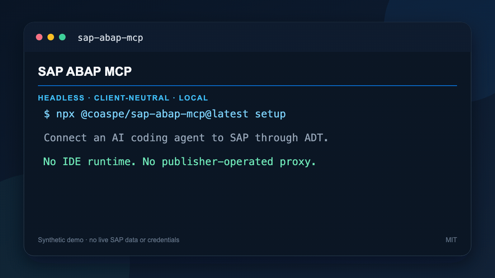

# SAP ABAP MCP

Connect your AI assistant to an ADT-enabled SAP system to read ABAP, make scoped changes and inspect actual check results.

- **Small gateway:** the current checkout's five-tool minimal mode measured **1,024 estimated initial tokens** in an offline fixture; an earlier measurement was 961.
- **Six hosts:** start onboarding with one command for Claude Code, Codex, VS Code, Cursor, Gemini CLI or Claude Desktop.
- **Headless transport assurance:** run `assure` in CI to evaluate configured checks without releasing the transport.

SAP's official ADT MCP is IDE-integrated and overlaps with development and ATC workflows. Live-SAP verification and policy approval are separate.

## Quick start: launch in 30 seconds

Launching the command is quick; connection setup, VPN and SAP authorization can take longer.

1. Install Node.js 22/24 and connect to your company VPN.
2. Run `npx -y @coaspe/sap-abap-mcp@2.3.0 onboard` (`npx.cmd` on Windows).
3. Verify and save your SAP connection, register your host, then restart the app and verify an actual SAP system read.

| Host | Setup command |
|---|---|
| Claude Code | `npx -y @coaspe/sap-abap-mcp@2.3.0 onboard` |
| Codex | `npx -y @coaspe/sap-abap-mcp@2.3.0 onboard` |
| VS Code | `npx -y @coaspe/sap-abap-mcp@2.3.0 register DEV100 --client vscode --apply` |
| Cursor | `npx -y @coaspe/sap-abap-mcp@2.3.0 register DEV100 --client cursor --apply` |
| Gemini CLI | `npx -y @coaspe/sap-abap-mcp@2.3.0 register DEV100 --client gemini --apply` |
| Claude Desktop | `npx -y @coaspe/sap-abap-mcp@2.3.0 register DEV100 --client claude-desktop --apply` |

## Try a practical prompt

- "In DEV100, find class ZCL_EXAMPLE and explain the public methods; do not change anything."
- "Compare the implementation of ZCL_EXAMPLE in DEV100 and QAS200 and report differences."
- "Inspect transport DEVK900123, run the approved checks, and report failures without releasing it."

Version **2.2.0** includes company CA files, six-host registration and Windows SAP
Logon import. Omit `--apply` to preview a registration; existing entries are
preserved and existing settings files are backed up. Claude Desktop MCPB users
should avoid a duplicate registration. On Windows replace `npx` with `npx.cmd`.

CA profiles use file format version 3 and need 2.2.0 or later. Existing npm
registrations pin their package version: restart alone does not update a 2.1.0
registration. Use `registration doctor` and review the repair
to update a pinned registration to the version you intend to run.

**2.1.0** fixes noninteractive startup, native macOS credential storage and
registration recovery. Windows DPAPI explicitly loads its native security module
even when Node inherits a PowerShell 7 module path. Bundled npm/npx Windows
launchers are resolved without a shell while preserving custom wrappers. This release also reduces the runtime package. Patched vendor bytes are preserved across Windows
and Unix checkouts. Existing five gateways still reach 120 capabilities.

## What's new in 2.3.0

- **Transport release and inspection.** Discover the SAP ADT background endpoint before release, verify the exact Request or Task, and keep Task-before-Request ordering. CTS object addition confirms the exact key on read-back and avoids duplicate writes.
- **ATC results.** Isolate worklists, keep findings that match the target, and count each resolved transport object once. Incomplete evidence stays visible in the gate.
- **Source and data controls.** Open ADT links from supported results, read active source explicitly, and scope class changes to a method. The ADT client sends the reconstructed source. The data policy can block configured table and view names before a query reaches SAP.

See the [2.3.0 changelog](https://github.com/Coaspe/sap-abap-mcp/blob/v2.3.0/CHANGELOG.md#230--2026-11-20) and [verification limits](#verified-environments-and-limits).

## One existing-object change

Select the existing `sap-change-object` prompt, with the configured `systemId`,
exact Z program/class as `target`, and desired behavior in `goal`. It reuses
source, semantic/public API, dependency, quality and transport features.

Production/read-only policy, package restrictions, transport requirements and
exact-source checks remain enforced. Source writes recheck the same current-source view under lock, without an explicit inactive
probe. A changed current version stops the write. Requested activation follows
successful unlock and is skipped on syntax errors. Uncertain
multi-object writes stop with saved/uncertain/unattempted identities; there is
no automatic rollback or atomic-transaction claim. Inspect state before retrying.
Zero tests, unsupported checks and partial findings cannot establish completion.

For a read-only evaluation, keep `readOnly: true` and expose only search,
describe and invoke_read gateways in the host. Do not execute write, activation,
Unit, ATC, debugger or profiling operations during that evaluation.

## Verified environments and limits

| Scope | Evidence and limit |
|---|---|
| Clean npm tarball, macOS arm64, Node 24 | Eight launch/profile combinations, Unicode/spaces, help, invalid commands and shutdown passed on the reliability candidate |
| macOS Keychain | Actual throwaway legacy-item/UTF-8/9,000-byte storage, renewal and deletion passed |
| Windows read-only field procedure | Owner reports all supplied steps passed without candidate source changes; sanitized operation records were not supplied |
| Windows DPAPI / npx.cmd automation | Windows CI passed for native storage/module-shadow regression, bundled launchers and eight installed-tarball protocol cases |
| Native Desktop MCPB / host restart | Standalone bundle checks and an owner's overall field report remain distinct from retained app-level evidence |
| Current 2.x live-SAP acceptance | **not verified** across the complete feature set on the published artifact. Field evidence for specific pre-release cases is listed below. |
| SAP transport acceptance | A pre-release build passed Request and Task release, exact Request/Task lookup, CTS add verification and duplicate prevention in a development SAP system. This covers those cases in that build and environment. |
| V4 service unpublish | Live verification remains open. The development client blocked publication of the test service. |
| Multi-page transport search and customer CI | Live multi-page search lacked a fixture with multiple result pages. No accessible customer CI pipeline was available for integration verification. |
| Historical live SAP / model comparison | 2026-08-05 results are historical; no identical-model T1–T5 completion rate or product ranking is established |

Known SAP limitations from earlier field runs: older requests may be missing when the SAP system does not advertise all-date search. Top-level package creation was rejected by the tested backend. Separate `LIMU DOMD` registration was not observed in a task already containing the parent `R3TR DOMA`; the tool verifies the requested key before reporting success. The acceptance kit skips lookup of previous ABAP Unit runs.

Candidate measurements reduced compressed npm size from 26.29 to 13.33 MB and
installed dependency bytes from 118.89 to 91.81 MB. Three warm protocol sessions
measured 346–351 to 223–239 ms. Cold install was 12.92 to 16.06 seconds; no cold
speed improvement is claimed.

## If setup fails

| Symptom | Next action |
|---|---|
| MCP closes immediately | Keep `serve` explicit, especially on 2.0.1; verify Node on the host PATH |
| `SETUP_REQUIRED` | Complete local setup and reconnect; this state is not an accepted SAP installation |
| Removed Node/cache or old registered version | Run `registration doctor` and review the repair |
| Certificate untrusted / expired / hostname mismatch | Keep verification enabled; use the company CA PEM file or ask the administrator to fix the certificate/URL. |
| SAP URL unknown | On Windows use SAP Logon import to find candidate URLs, then check ADT and confirm the endpoint with your administrator |
| SAP authentication/authorization failure | Renew locally or ask the administrator for ADT permission; avoid blind repeated logins |
| Inactive conflict / uncertain write | Read current active/inactive state and reconcile with its owner before resuming |

## Reference and release status

- [Setup](llms-install.md), [changelog](CHANGELOG.md), [roadmap](ROADMAP.md), [adopters](ADOPTERS.md), [2.3.0 release](https://github.com/Coaspe/sap-abap-mcp/releases/tag/v2.3.0).

Checkout manifest version: `2.3.0`.

Normal clients should omit both `--api-version` and `--toolsets`.

## Privacy Policy

[PRIVACY.md](PRIVACY.md): no default remote telemetry. Credentials remain in
OS-protected storage. Feedback exports are voluntary; public adopter names and
quotes require separate explicit permission. Downloads and automated tests do
not establish active users, task success or independent adoption.
